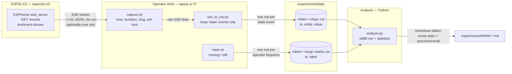

# Experiment capture — Data-flow diagram

UML data-flow of the experiment tooling (issue #6): how a run's movement scores and the
manual ground truth travel from the module to the markdown table pasted into the
experiment journal. The firmware is untouched: the only source is the ESPHome
`web_server` Server-Sent-Events stream.

Decision record: MCDA 2026-10-23 — SSE + Python (410/500) chosen over MQTT + Python (350,
design fallback) and Home Assistant recorder (335). See `PROJECT_LOG.md`.

## Notes

- `capture.sh` runs `curl` (locally, or on the ssh host when the module is on another
  LAN) and pipes the stream into `sse_to_csv.py`, which keeps only `event: state`
  payloads and flattens them to `timestamp,entity,value` (`ping` and `log` events are
  dropped; truncated or valueless payloads are skipped with a warning).
- Ground truth is manual: during a run the operator presses a key in `mark.sh` each time
  the real situation changes (`moving` ↔ `still`). A mark holds until the next one;
  a run with no mark is treated as `still` end to end (baseline run).
- `analyze.py` is pure: files in, markdown out, no network. Threshold is an argument
  (defaults to the device's 0.4) so several thresholds can be evaluated on the same CSV.
- Data files contain the entities the web server exposes (movement score, motion state,
  threshold, calibrate switch), never raw CSI (see `docs/privacy.md`).
- 24/7 continuous recording is out of scope: the stream is one `curl` bounded by
  `--max-time`, with no reconnection.
  The MQTT fallback (option B) would replace `capture.sh` only; `analyze.py` is reused.
