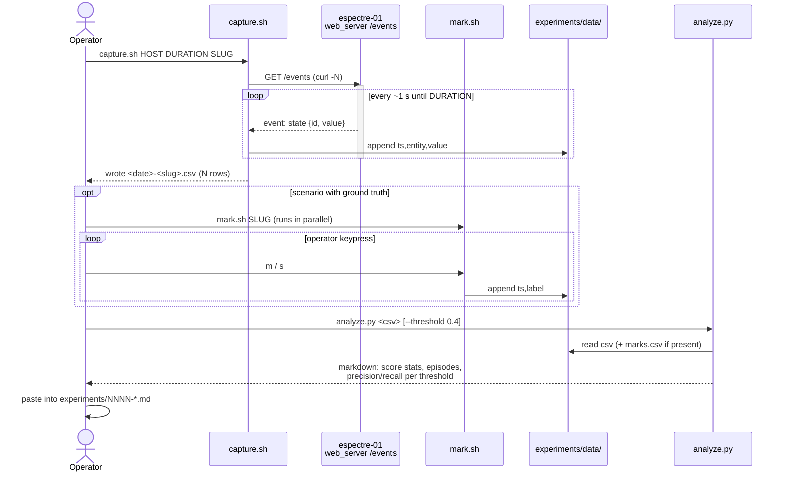

# Experiment capture — Sequence diagram (one run)

Actor-initiated goal: *"Measure how the module scores a scenario and compare it with
what really happened"*. One run = one capture + optional marks + one analysis.

## Notes

- `capture.sh` and `mark.sh` run in two terminals; they share only the run slug and the
  wall clock. Both hosts must be NTP-synced (the Pi and the laptop are).
- `analyze.py` never contacts the device: a journal entry can be recomputed later from the
  committed CSV, with another threshold.
